# LabelHive — End-to-end tutorial

This walks through LabelHive from a fresh start: the data model in 60 seconds,
how an admin builds a job, how a worker labels, and how the quality controls
(gold mixing, trust scoring, agreement, escalation, concerns) actually fire on
real data. Every screen shown here is the demo-seeded UI — you can reproduce
each shot by following the steps and viewing the same URL.

For setup commands see [`RUN.md`](RUN.md); for the runtime architecture see
[`ARCHITECTURE.md`](ARCHITECTURE.md); for build/CI see [`BUILD.md`](BUILD.md).

> **All screenshots in this tutorial were captured against the seeded demo
> data.** If yours look different, check that `DATALABEL_DEMO_SEED_ON_STARTUP=true`
> was set the first time the backend booted (see `k8s/20-backend.yaml`).

---

## Table of contents

1. [What LabelHive is](#1-what-labelhive-is)
2. [Concepts in 60 seconds](#2-concepts-in-60-seconds)
3. [Getting it running](#3-getting-it-running)
4. [Signing in (debug auth)](#4-signing-in-debug-auth)
5. [Admin walkthrough](#5-admin-walkthrough)
   - 5.1 [The Jobs dashboard](#51-the-jobs-dashboard)
   - 5.2 [Building a job](#52-building-a-job)
   - 5.3 [Job detail — settings, units, gold](#53-job-detail--settings-units-gold)
   - 5.4 [Monitor — live progress](#54-monitor--live-progress)
   - 5.5 [Reports — agreement, completion, worker trust](#55-reports--agreement-completion-worker-trust)
   - 5.6 [Worker review — drilling into a single labeler](#56-worker-review)
   - 5.7 [Concerns — the data-quality inbox](#57-concerns--the-data-quality-inbox)
6. [Worker walkthrough](#6-worker-walkthrough)
   - 6.1 [The worker feed](#61-the-worker-feed)
   - 6.2 [Multiple choice](#62-multiple-choice)
   - 6.3 [Span annotation](#63-span-annotation)
   - 6.4 [Search relevance](#64-search-relevance)
   - 6.5 [Image classification](#65-image-classification)
   - 6.6 [Bounding box](#66-bounding-box)
   - 6.7 [Instructions, skips, and concerns](#67-instructions-skips-and-concerns)
7. [Driving LabelHive from outside the UI](#7-driving-labelhive-from-outside-the-ui)
   - 7.1 [REST](#71-rest)
   - 7.2 [Python SDK](#72-python-sdk)
   - 7.3 [MCP for AI agents](#73-mcp-for-ai-agents)
8. [Quality knobs — what to tune when](#8-quality-knobs--what-to-tune-when)

---

## 1. What LabelHive is

A **crowd labeling** platform: you upload a dataset, a swarm of workers grades
each unit, and LabelHive produces a single trusted label per unit by mixing
**gold** (questions whose answer you already know) into the workflow,
**scoring** each worker against the gold, **quarantining** untrustworthy
workers, and **promoting** units whose remaining workers agree strongly enough.

That sounds like CrowdFlower / Figure Eight because that's the lineage. The
differences:

- **Local-first**: Spring Boot + Postgres + a React frontend. No SaaS.
- **Plugin templates**: built-ins cover multi-choice through bounding box and
  span annotation; you can add a new template type by dropping a JAR — see
  [`templates/CUSTOM_TYPE_TUTORIAL.md`](templates/CUSTOM_TYPE_TUTORIAL.md).
- **Three control surfaces**: a web UI, a typed Python SDK, and an MCP server
  for AI agents.

---

## 2. Concepts in 60 seconds

| Term | Means |
|---|---|
| **Job** | A labeling project — one template type, one set of settings, one dataset. |
| **Unit** | One row of data to be labeled. Either *regular* (unknown answer) or *gold* (known answer, used to grade workers). |
| **Judgment** | One worker's answer on one unit. |
| **Template** | The shape of the question and answer. Six built-ins: multi-choice, free-text, image classification, search relevance, span annotation, bounding box. |
| **Gold cadence** | Frequency of gold injection — `1 gold per N non-gold` units in each worker's feed. |
| **Trust floor** | A worker whose gold-accuracy drops below this gets quarantined (their judgments stop counting). |
| **Promote agreement min** | The minimum *pairwise agreement* on a unit before LabelHive promotes the consensus to gold (only when *Auto-promote* is on). |
| **Min/Max judgments per unit** | LabelHive collects at least `min` independent judgments. If they don't agree it escalates up to `max`. |
| **End-of-work message** | What workers see when the job has nothing left for them right now. |
| **Concern** | A worker flag that the *data* (not the answer) looks wrong — collected for admin review. |

That's the entire conceptual surface. The rest is settings.

---

## 3. Getting it running

The repo ships an asset manifest (`devportal.yaml`) that registers it with
the [dev_portal](https://github.com/geekychris/dev_portal); from there it's a
two-button deploy. Without dev_portal, follow [`RUN.md`](RUN.md).

The fastest path that produces the demo data shown in this tutorial:

```sh
docker build -t labelhive/backend:latest  -f backend/Dockerfile  backend
docker build -t labelhive/frontend:latest -f frontend/Dockerfile frontend
kubectl apply -f k8s/
kubectl -n labelhive rollout status deploy/backend
open http://localhost:30009
```

The seeder runs once on first boot and creates 4 users + 6 jobs covering all
six template types.

---

## 4. Signing in (debug auth)

LabelHive ships with a **debug profile** (`SPRING_PROFILES_ACTIVE=debug`) that
resolves the current user from an `X-User-Id` header instead of a real
session. The frontend writes whatever you pick from the user-switcher into
`localStorage['debugUserId']` and attaches it to every API call.


The seeded users are:

| Username | Role | Use for |
|---|---|---|
| `demo` | ADMIN | Building & monitoring jobs |
| `alice`, `bob`, `carol` | WORKER | Labeling |

Production deployments should drop the `debug` profile or set
`datalabel.debug-auth=false` — the same backend then enforces real form-login
+ BCrypt-hashed passwords. Until you do that, **do not expose the NodePort
externally**.

---

## 5. Admin walkthrough

### 5.1 The Jobs dashboard

Sign in as `demo` and you land on the Jobs dashboard at `/`. Each card shows
the job's template type, its quality settings inline (gold cadence, page
size, judgments per unit, trust floor), and its status.

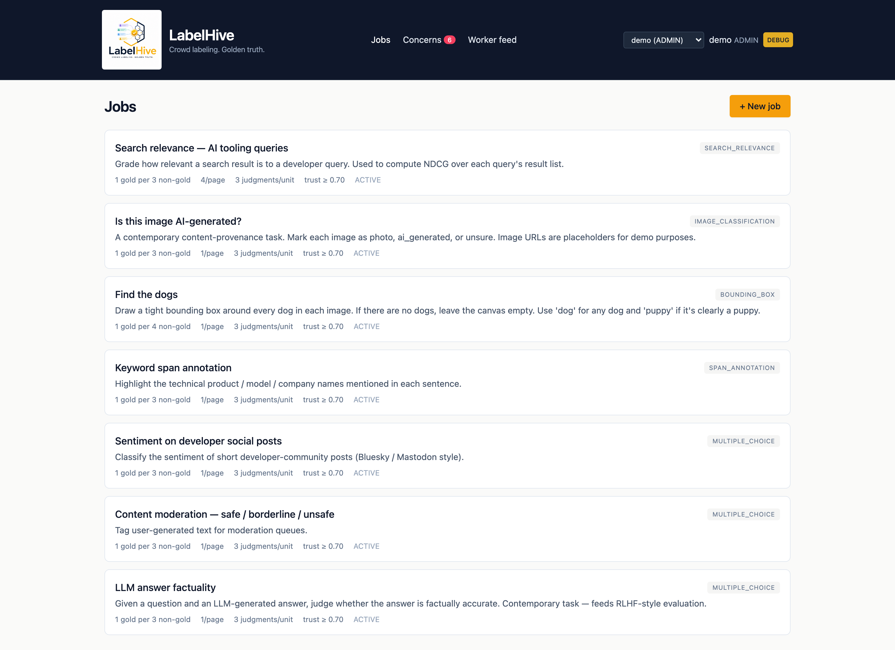

The seven seeded jobs cover every template type — useful as live-fire
references when you build your own. Click any card to drill in; click **+ New
job** to start a fresh one.

### 5.2 Building a job

The **Build a job** screen is a 7-step form. You can navigate freely between
tabs — nothing is committed until you click *Save* on the Review tab.

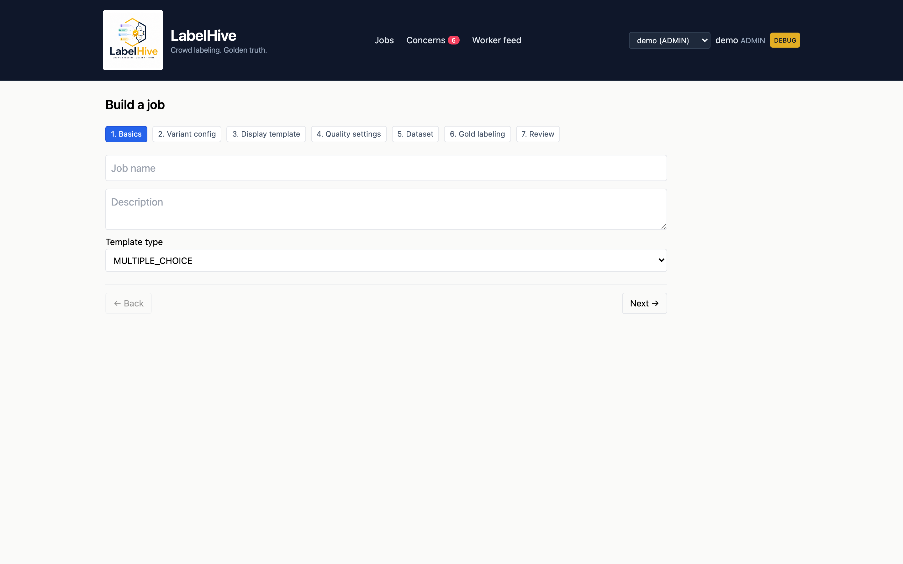

| Step | What you set |
|---|---|
| **1. Basics** | Name, description, *template type* (drives the rest of the wizard). |
| **2. Variant config** | Template-specific settings — e.g. multi-choice: the choice list, allow-multiple flag. Search relevance: the grade scale + which payload field is the query id. |
| **3. Display template** | Optional Mustache string for re-rendering the unit's payload (useful when your data is denser than the default renderer can show). |
| **4. Quality settings** | Gold cadence, min/max judgments per unit, trust floor, promote-agreement min, auto-promote-to-gold flag, end-of-work message. |
| **5. Dataset** | Upload units. The right pane shows the expected JSONL/CSV columns *for this template type* — see [`DatasetFormatHelper`](../frontend/src/components/DatasetFormatHelper.tsx). |
| **6. Gold labeling** | Pick units from the just-uploaded dataset and provide the known-correct answer. Gold can also be added later via the Detail tab. |
| **7. Review** | Save. |

Two quality knobs deserve calling out at create time:

- **Min judgments == max judgments → fixed consensus**, every unit gets
  exactly that many independent labels.
- **Min < max → escalation**: LabelHive collects min, and if those workers
  disagree it pulls in additional ones up to max before giving up.

### 5.3 Job detail — settings, units, gold

The **Detail** tab is the job's editor. The settings card lives at the top
(everything you set in the wizard, now editable); below it are the upload
form and the unit table.

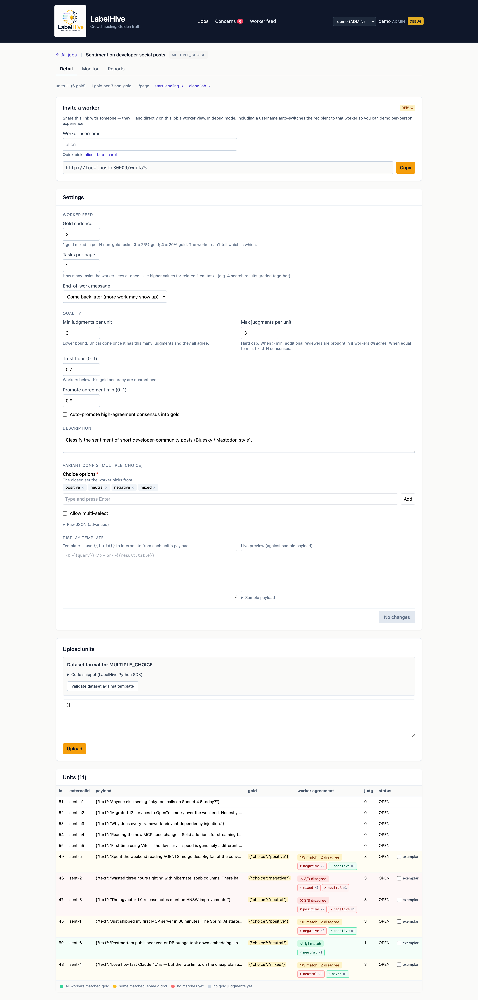

Every column on the unit table is meaningful:

| Column | Meaning |
|---|---|
| `id` / `extId` | Internal id / external id from the dataset upload. |
| `payload` | The data the worker sees — opaque JSON, rendered by the template. |
| `gold` | The gold answer if this is a gold unit; blank otherwise. |
| `worker agreement` | Computed pairwise agreement among judgments collected so far. |
| `judg.` | Number of judgments collected. |
| `status` | `OPEN` (collecting), `COMPLETE` (consensus reached), `PROMOTED` (turned into gold), `RETIRED`. |

You can flip a unit's `gold` field from this table — same effect as marking
it gold in the wizard. *Auto-promote* (off by default) does this automatically
once both `min judgments` and `agreement >= promote_agreement_min` are met.

For a search-relevance job the same screen looks like this — note the
template-driven column layout (each unit's payload includes a `queryId`,
which LabelHive groups by when computing per-query NDCG):

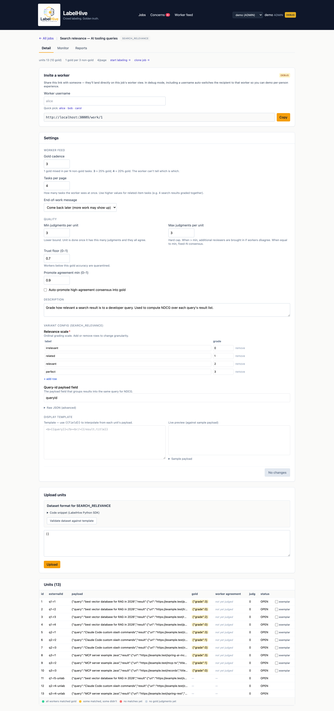

The **Invite a worker** card at the top of every Detail page generates a
deep link of the form `http://.../work/<jobId>` that drops the recipient
straight into the job's worker feed once they sign in. Useful when you don't
want a worker poking around the rest of the catalog.

### 5.4 Monitor — live progress

The Monitor tab is what you watch while a job runs. It polls.

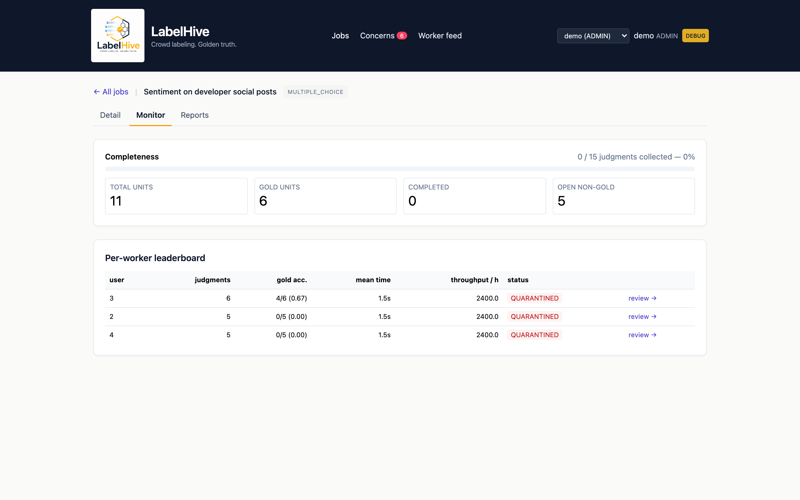

You get:

- **Per-unit table** with status & current judgment count, ordered by *units
  closest to consensus* — click through to inspect raw judgments.
- **Worker activity** — judgment counts and most-recent activity per worker
  on this job.

If the queue stalls, the most common cause is workers being quarantined
faster than they can be unquarantined; check Reports next.

### 5.5 Reports — agreement, completion, worker trust

Reports is the post-mortem (and continuous-quality) view.

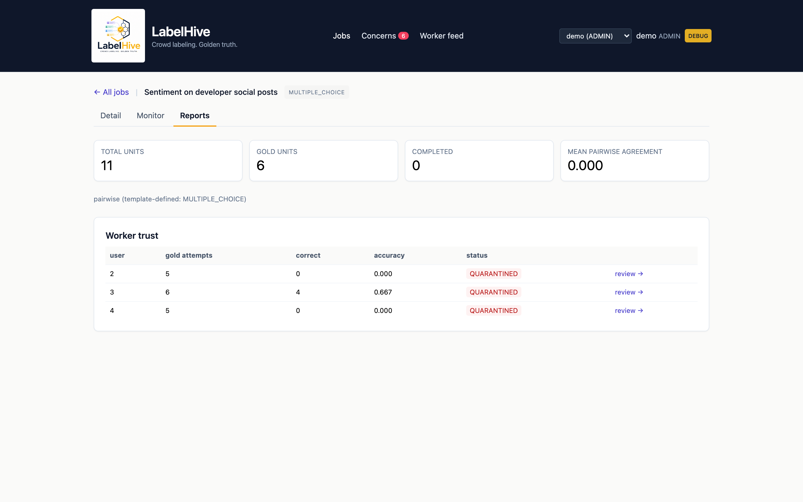

The four stat cards at the top:

| Card | What it tracks |
|---|---|
| **Total units** | Everything in the job — gold + regular. |
| **Gold units** | The subset you've marked as known-answer. |
| **Completed** | Units whose status is COMPLETE or PROMOTED. |
| **Mean pairwise agreement** | Across non-gold units; a leading indicator of dataset health. |

The **Worker trust** table is the heart of LabelHive's quality enforcement.
For each worker who has touched a gold unit on this job, you see:

- **gold attempts** — how many gold units they answered
- **correct** — how many they got right
- **accuracy** — `correct / attempts`
- **status** — `TRUSTED` or `QUARANTINED` (their accuracy fell below the job's
  trust floor — their judgments are *no longer counted toward consensus on
  any unit*, but the system keeps feeding them more gold so they can recover)

Click **review →** to dig into one worker.

> **Job-specific stat panels.** Some templates surface a template-defined
> aggregate. E.g. SEARCH_RELEVANCE adds a per-query NDCG panel; SPAN_ANNOTATION
> adds an F1-by-label panel. The block under "*pairwise (template-defined: …)*"
> is where these appear.

### 5.6 Worker review

`/jobs/:id/workers/:userId` is the per-worker timeline. You see every
judgment they've made on this job, the gold answer (if it was a gold unit),
their answer, and whether it was scored correct.

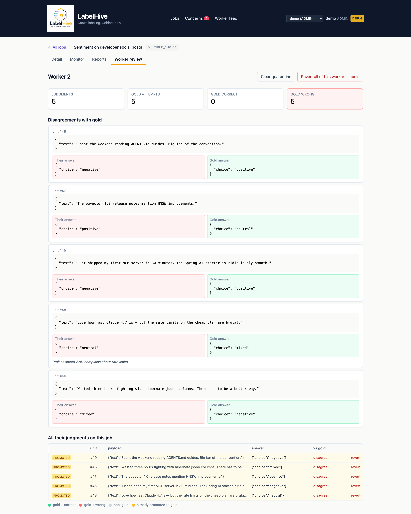

Use this to **un-quarantine deliberately**: if you spot that a worker was
quarantined due to bad gold (i.e. *your* mistake), fix the gold, and as new
gold attempts come in their accuracy climbs back over the trust floor and
they auto-rejoin.

### 5.7 Concerns — the data-quality inbox

Workers can raise a concern on any unit ("this image is corrupted", "the
question contradicts itself"). The Concerns screen is the global inbox.

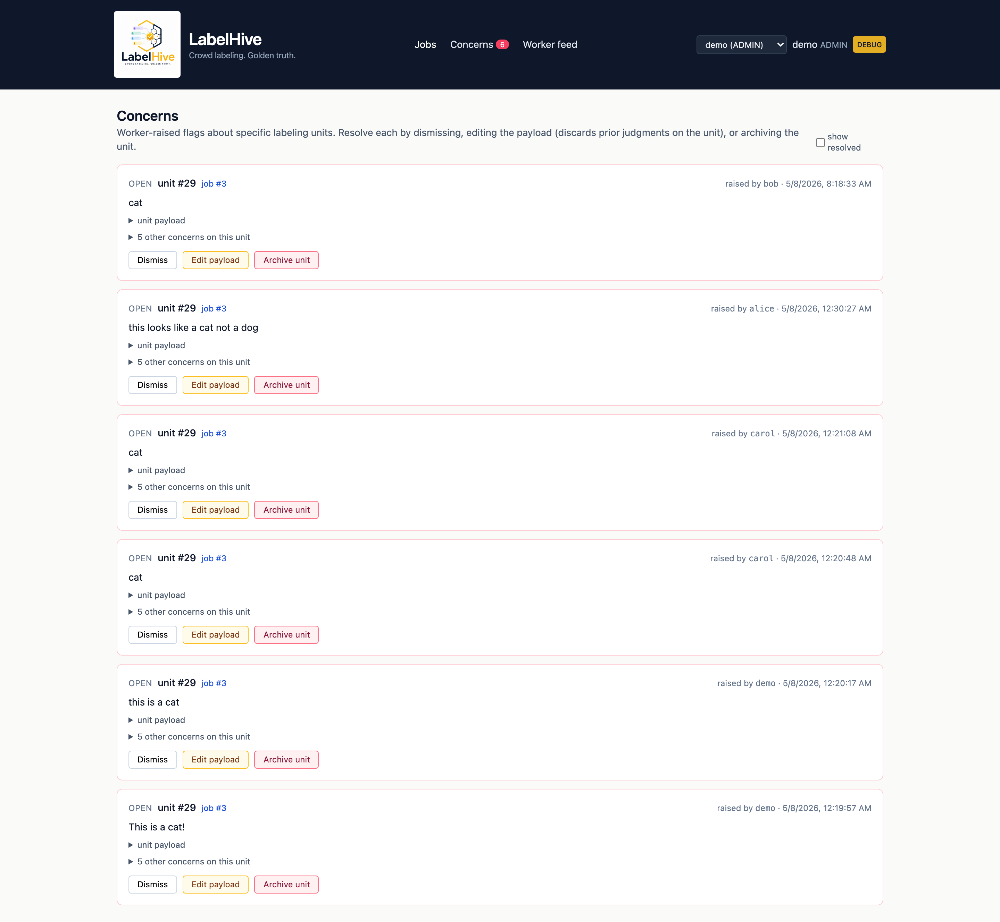

The badge in the header (`Concerns 6`) polls every 10s, so you're nudged
without refreshing. From the inbox you can mark a concern *resolved* (often
after retiring the offending unit) or *dismissed* (false alarm). Concerns are
not deduped per-unit, so multiple workers raising the same concern is the
signal you're looking for.

---

## 6. Worker walkthrough

### 6.1 The worker feed

Switch the user-switcher to `alice`. The feed at `/work` lists every job that
currently has tasks for *you*. Click in to start labeling.

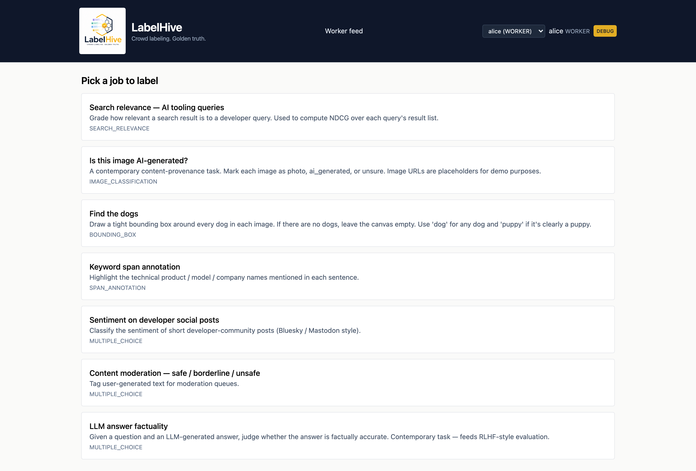

### 6.2 Multiple choice

The simplest template. The payload's `text` field renders as the question;
the choice list comes from the job's variant config.

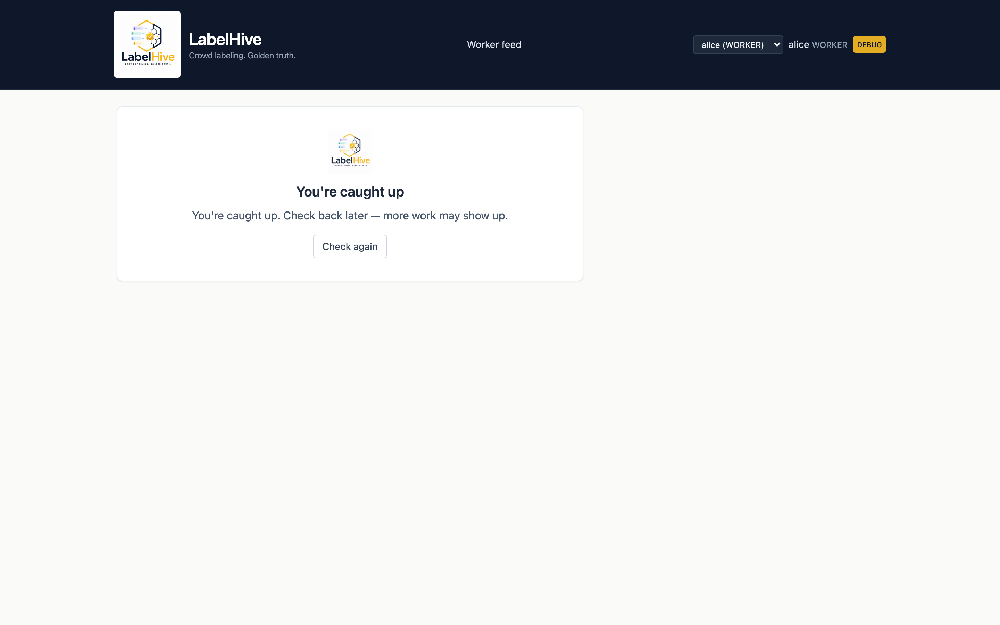

Keyboard shortcuts are first-class — press `1`–`N` to pick the
corresponding choice, then `Enter` to submit & advance. The yellow border
shows which task on the page is currently focused.

### 6.3 Span annotation

You're picking *substrings* in the text and tagging them. The active label
chip at the top is what you'll apply when you click — press `1`–`N` to
swap labels.

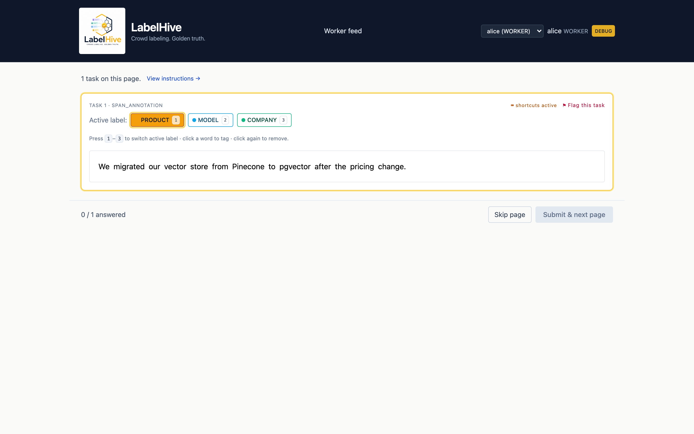

Click a word once to add it to the current span; click again to remove it.
Spans for different labels live in independent layers, so you can tag the
same span twice (e.g. as both "PRODUCT" and "MODEL") if your scheme allows
overlapping types.

### 6.4 Search relevance

Each unit is a *(query, result)* pair; you grade how relevant the result is
to the query on the configured ordinal scale (here: irrelevant / related /
relevant / perfect).

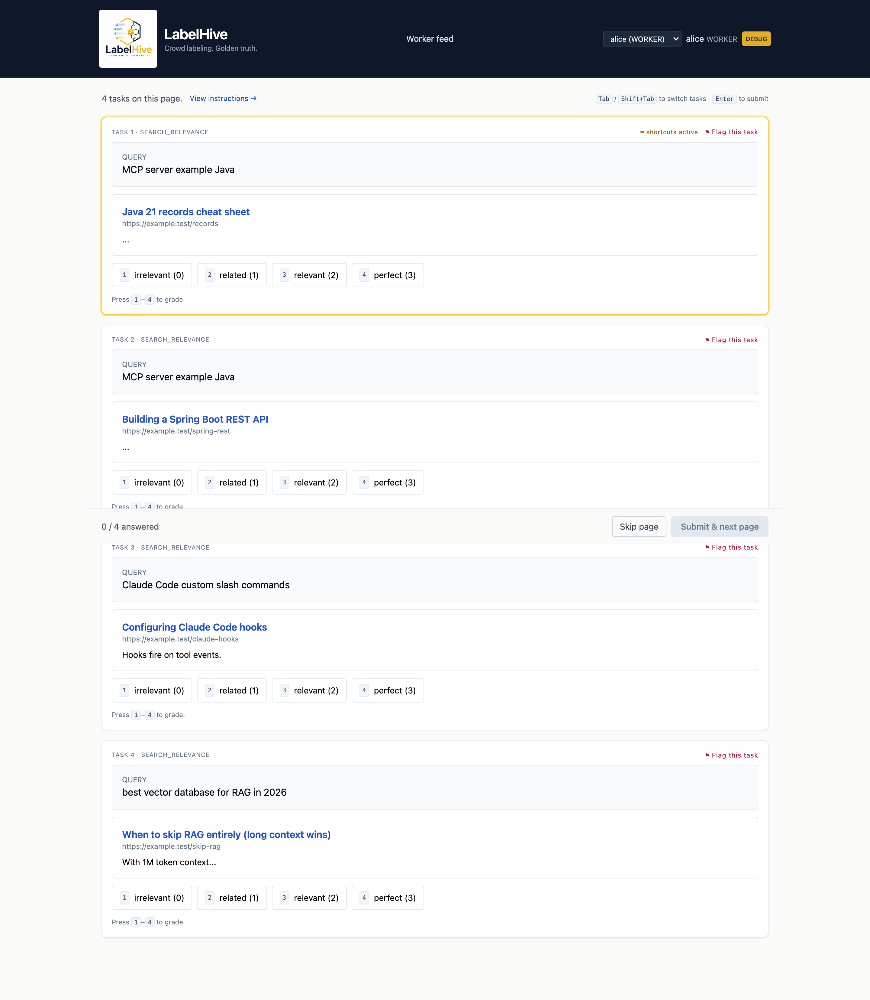

This template gives partial credit on gold: pick a grade adjacent to the
correct one and you get part of the point — flexibility configured by the
template type's evaluator (see `SearchRelevanceTemplate.evaluate(...)`). The
admin's per-query NDCG panel comes from these gradings.

### 6.5 Image classification

A multi-choice task whose payload is an image URL.

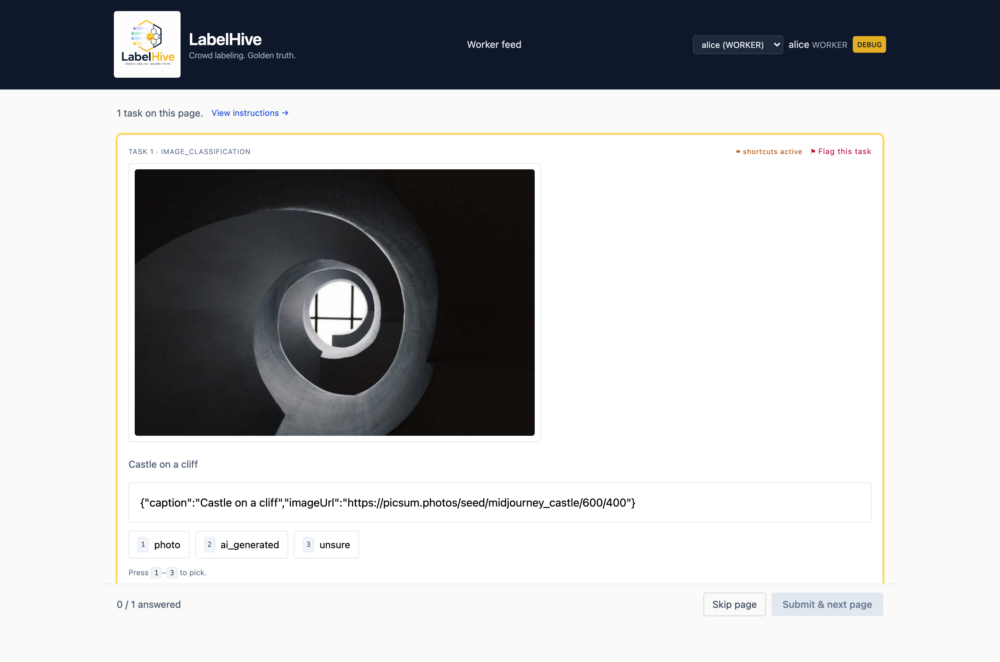

Treat it exactly like multi-choice: pick a class, submit. The image is fetched
from whatever URL the dataset row contains.

### 6.6 Bounding box

Draw boxes on the image. Pick the active label from the chips at the top of
the unit ("dog" vs "puppy" in the demo), then click-drag on the canvas to
define a box. Boxes are stored as image-pixel coordinates.

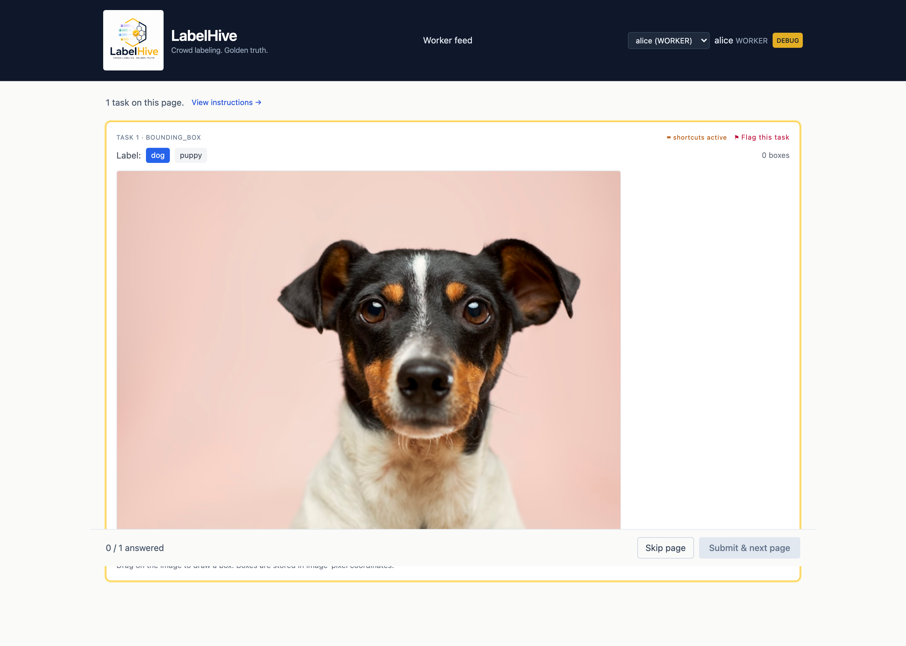

If there's nothing to box (empty class), submit with zero boxes — the
template's IOU evaluator handles that case explicitly.

### 6.7 Instructions, skips, and concerns

Every task page has three escape hatches:

- **View instructions** at the top — opens the job's instructions page.
- **Skip page** — drops the current page; you'll get different units next.
- **Flag this task** (top-right corner of the task card) — raises a concern;
  shows up in the admin's Concerns inbox.

The instructions page itself is rendered from the job's `description` plus
any *exemplar* units you marked in the Detail tab.

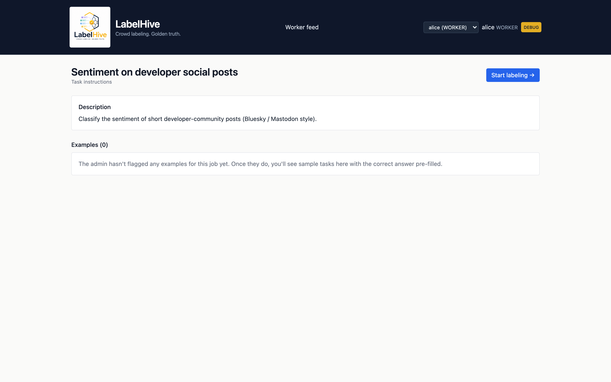

---

## 7. Driving LabelHive from outside the UI

### 7.1 REST

Every screen above is a thin wrapper over a REST endpoint. Quick sketch:

```sh
# Sign-in (debug profile — supply the user via header instead).
USER=alice

# Worker — fetch the next page of tasks for a job.
curl -s -H "X-User-Id: $USER" \
  http://localhost:30009/api/jobs/5/tasks/next

# Worker — submit a judgment.
curl -s -H "X-User-Id: $USER" -H 'Content-Type: application/json' \
  -d '{"answer":{"choice":"positive"},"timeMs":1500}' \
  http://localhost:30009/api/jobs/5/tasks/46/judgment

# Admin — list jobs.
curl -s -H 'X-User-Id: demo' http://localhost:30009/api/jobs

# Admin — pull the worker-trust report.
curl -s -H 'X-User-Id: demo' \
  http://localhost:30009/api/admin/jobs/5/workers/2/judgments
```

The full controller surface lives under
[`backend/src/main/java/com/datalabel/controller`](../backend/src/main/java/com/datalabel/controller):
`JobController`, `TaskController` (worker), `AdminController`,
`ConcernAdminController`, `UnitController`.

### 7.2 Python SDK

[`sdk/python`](../sdk/python) ships a typed client + 7 runnable examples (one
per template type, plus an end-to-end "create job → upload data → simulate
workers → pull report" walkthrough). The shape is:

```python
from labelhive_sdk import LabelHive

lh = LabelHive("http://localhost:30009", debug_user="demo")

job = lh.create_job(
    name="Quick demo",
    description="Sentiment on tweets",
    template_type="MULTIPLE_CHOICE",
    template_config={"choices": ["pos", "neu", "neg"]},
    quality={"min_judgments": 3, "max_judgments": 5, "trust_floor": 0.7,
             "gold_cadence": 3, "promote_agreement_min": 0.9},
)

lh.upload_units(job.id, [{"extId": "t1", "payload": {"text": "..."}}])
lh.add_gold(job.id, "t1", {"choice": "pos"})

# Worker simulation:
worker = lh.as_user("alice")
page = worker.next_tasks(job.id)
for unit in page.tasks:
    worker.submit(job.id, unit.id, {"choice": "pos"}, time_ms=1200)

print(lh.report(job.id).worker_trust)
```

See `sdk/python/examples/` for full runnable scripts.

### 7.3 MCP for AI agents

LabelHive exposes the same admin surface over the **Model Context Protocol**
at `/mcp` — point Claude / Cursor / any MCP client at the URL and you get
tools like `create_job`, `upload_units`, `set_gold`, `get_report`. Lets an
agent drive the entire labeling lifecycle without touching the REST API
directly.

The tool definitions live in
[`backend/src/main/java/com/datalabel/mcp/DataLabelTools.java`](../backend/src/main/java/com/datalabel/mcp/DataLabelTools.java).

---

## 8. Quality knobs — what to tune when

A reference card for the inevitable "what should I set this to?":

| Symptom | Knob to move | Direction |
|---|---|---|
| Workers running out of work too fast on a small dataset | `tasks per page` | **down** — smaller pages = more chances to inject gold + recheck trust |
| Lots of low-agreement units stalling at `min judgments` | `max judgments` | **up** — escalation kicks in to break ties |
| Trusted workers mostly disagreeing → bad data, not bad labelers | Investigate the *unit*, raise a concern — don't just lower the trust floor |
| New workers being quarantined too aggressively | `trust floor` | **down** *or* increase `gold cadence` so a single early miss doesn't tank accuracy |
| Want to bootstrap gold from existing high-confidence units | `auto-promote to gold` | **on**, with `promote agreement min ≥ 0.9` |
| Workers see "come back later" too often | The job is healthy; either upload more units or relax `min judgments` |

When in doubt, leave the defaults — they came out of the same playbook the
demo seeder uses, and they're a reasonable starting point for most jobs.

---

*Tutorial last regenerated against the demo seed on the date of the commit
that added it. Screenshots will drift if you change the UI; regenerate them
with the Playwright script under `/tmp/labelhive_screenshots.py` (kept in the
maintainer's workspace, not committed) — see the README for details.*
